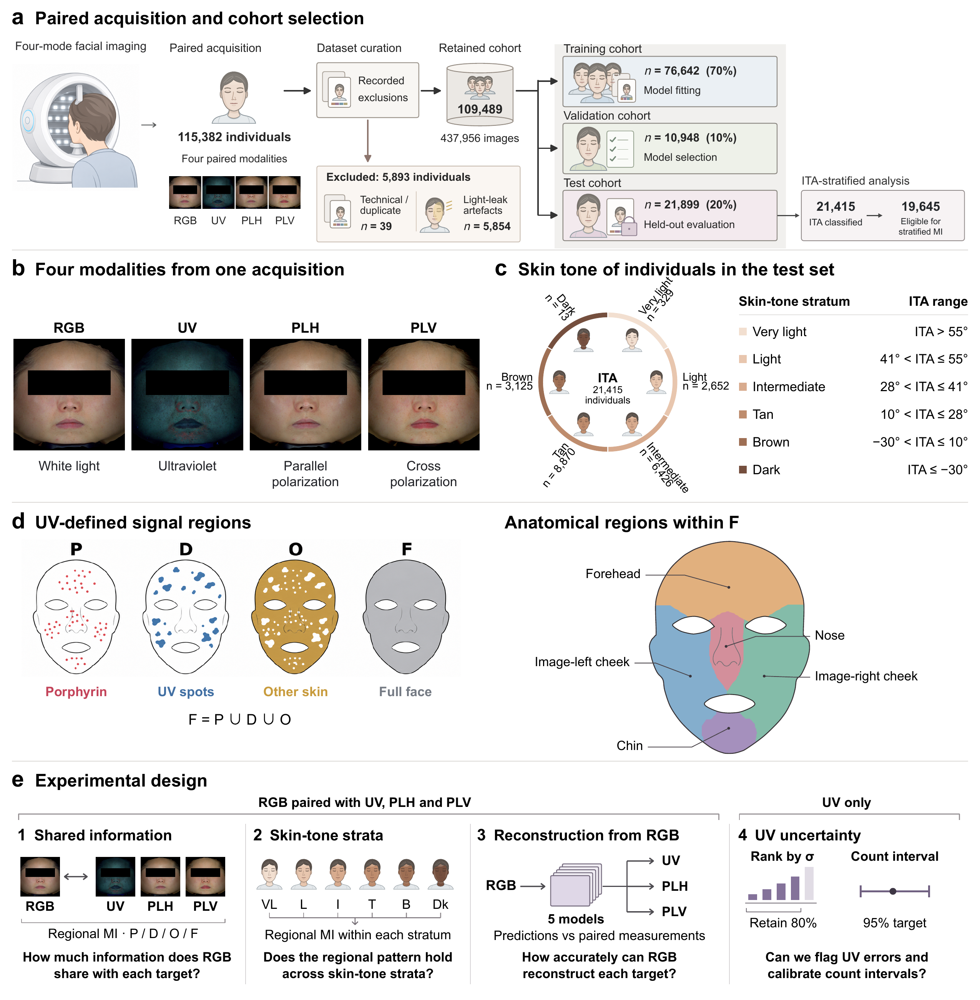

# SIIBA · Skin Image Information Boundary Atlas

<!-- University emblem © CUHK-Shenzhen. Source: https://www.cuhk.edu.cn/sites/default/files/inline-images/logo-1.png -->
<a href="https://www.cuhk.edu.cn/en/page/4987"></a>

[香港中文大学（深圳） · The Chinese University of Hong Kong, Shenzhen](https://www.cuhk.edu.cn/en/page/4987)

**How much information about skin can a white-light RGB photograph recover?** SIIBA pairs each RGB photograph with UV-excited fluorescence (UV), parallel-polarized light (PLH) and cross-polarized light (PLV) images from the same session.

**Study cohort** · 109,489 four-modality acquisitions · 437,956 images

## 🧭 Overview

Paired measurements let us ask where RGB shares information with the other modalities, whether that pattern holds across skin tones, and which signals a reconstruction preserves. The study uses 76,642 acquisitions for training, 10,948 for validation and 21,899 for testing. The number eligible for each analysis depends on facial geometry and the number of valid pixels in each region.

[](assets/figure1.png)

**Figure 1. Study cohort, facial regions and experimental design.**

## 🔬 Experiments

### 1. Information shared with RGB

We estimate mutual information between RGB and each target across the full valid face. We repeat the comparison in three regions defined on measured UV images (porphyrin signals, UV spots and other valid skin) and vary pixel sampling and image resolution. [Regional MI](research/mutual_information/) · [Resolution](research/resolution/) · [Context probes](research/context/)

### 2. Variation across skin tones

We derive the individual typology angle (ITA) from native RGB pixels inside the valid face mask. We repeat the regional comparisons in six ITA strata to see whether the ordering changes with skin tone. [ITA labelling](research/ita_labelling/) · [Cohort and split](research/cohort/) · [Facial masks](research/geometry/)

### 3. Reconstruction from RGB

Five model families predict UV, PLH and PLV from RGB. We compare predictions with the measured images across the face and within anatomical regions. For UV we also assess counts, burden and spatial matching of porphyrin signals and UV spots. [Models and training](research/training/README.md) · [Model definitions](research/models/README.md)

[UV reconstruction](research/uv_reconstruction/README.md) · [Polarized-light evaluation](research/pl_test/README.md) · [Anatomical agreement](research/full_face_agreement/README.md) · [UV objects](research/uv_objects/README.md) · [Spatial matching](research/uv_spatial/README.md) · [Registration controls](research/registration/README.md)

### 4. Uncertainty in reconstructed UV

We test whether predicted uncertainty identifies larger reconstruction errors. Split conformal calibration assesses prediction interval coverage and width, and selective-risk analysis measures how error changes when lower-uncertainty acquisitions are retained. [Uncertainty and calibration](research/uv_calibration/README.md)

## 🧪 Run the code

These CPU checks exercise the mutual-information estimator, regional image metrics, uncertainty calculations and figure input checksums. Run them from the repository root.

```sh
python -m pip install numpy scipy pillow
python research/mutual_information/test_mi.py -v
python research/uv_calibration/smoke_test.py
python figures/render_figures.py --check-public
```

The training guide includes a synthetic forward pass for each architecture and a training update. The plotting guide gives the command, dependencies and inputs for each of the four main figures. [Training guide](research/training/README.md) · [Reproduce Figures 1–4](figures/README.md)

## Usage guide

- **Model training:** See the [training guide](research/training/README.md) for the expected input format.
- **Figure generation:** See the [figure input manifest](figures/input_manifest.json) for the inputs used by each figure.
